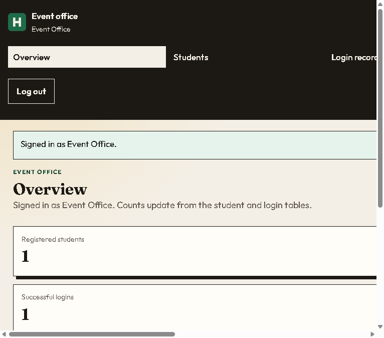
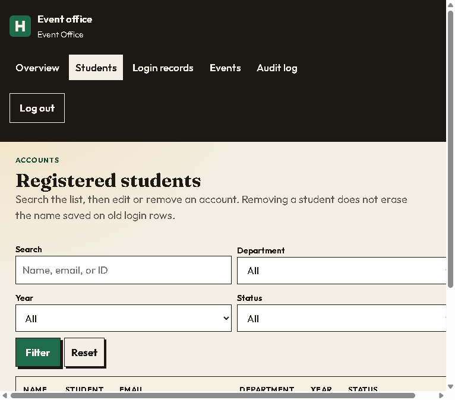
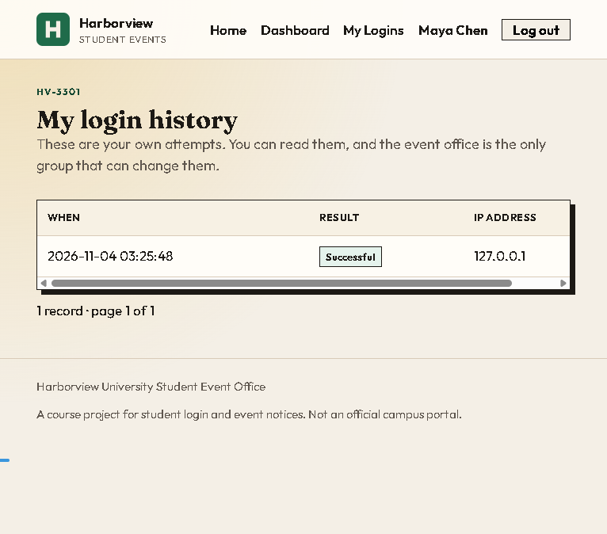

# Harborview Student Events

Harborview is a student event website with separate student and event-office
accounts. Students can browse and join events; administrators manage events,
student accounts, and login records.

## How it works

- Students create an account and confirm their email. A new email code is
  required each time they log in.
- Students can register for events. When an event reaches its capacity,
  additional students are waitlisted. Cancelling a place promotes the next
  student on the waitlist.
- Administrators use a separate login to manage events and their capacities,
  student accounts, and login records.
- The site has two app implementations: Vercel runs the JavaScript app in
  `lib/` and stores production data in Supabase; the Flask app uses the same
  templates and can run locally with SQLite.

## Screenshots

### Administrator dashboard



### Student management



### Student login history



## Run locally with Flask and SQLite

In PowerShell, from the project folder:

```powershell
python -m venv .venv
.\.venv\Scripts\Activate.ps1
python -m pip install -r requirements.txt
$env:SECRET_KEY = "replace-with-a-long-random-secret"
$env:DATABASE_BACKEND = "sqlite"
python app.py
```

Open `http://127.0.0.1:5000`. Keep real secrets in your local, ignored `.env`
file; do not commit them.

## Deploy to Vercel

The Vercel app uses Supabase and requires the database schema and production
environment variables to be configured first. Follow
[the Vercel deployment guide](docs/deploy-to-vercel.md) for setup details.

## Tests

```powershell
npm test
python -m pytest -q
```
